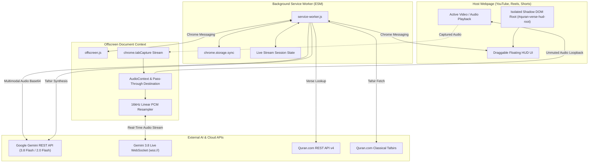

<h1 align="center">Quran Recitation Verse Identifier (Recitation Shazam)</h1>

<p align="center">
  <strong>Instant Quran recitation identification, live Ayah-by-Ayah streaming, and multi-source classical Tafsir synthesis for Google Chrome.</strong>
</p>

<p align="center">
  <a href="https://developer.chrome.com/docs/extensions/mv3/"></a>
  <a href="https://ai.google.dev/"></a>
  <a href="https://quran.com"></a>
  <a href="https://vitest.dev/"></a>
  <a href="LICENSE"></a>
</p>

<p align="center">
  <a href="#-key-features">Key Features</a> •
  <a href="#-quick-start">Quick Start</a> •
  <a href="#-how-to-use">How to Use</a> •
  <a href="#-technical-architecture">Architecture</a> •
  <a href="#-test-suite">Test Suite</a> •
  <a href="#-privacy--security">Privacy & Security</a>
</p>

---

## 📖 Overview

**Quran Verse Identifier** is a browser extension that functions as a "Shazam for the Quran." Whenever a Quran recitation is playing inside any browser tab—such as **YouTube, YouTube Shorts, Instagram Reels, Facebook, TikTok, podcasts**, or even **live ambient room audio via microphone**—a single shortcut (<kbd>Alt</kbd> + <kbd>Q</kbd>) instantly captures, identifies, and enriches the recitation.

Results are displayed in a sleek, draggable **Floating HUD** that renders authentic **Uthmani Arabic calligraphy**, verified translations in 13+ languages, **live continuous Ayah tracking**, and **simplified classical Tafsir reflections** with voice narration.

> [!IMPORTANT]
> **Lossless Unmuted Pass-Through:** Unlike standard tab audio capture implementations that mute playback while recording, this extension routes the stream through a custom `AudioContext.destination` loopback so your video audio **never mutes** in your headphones or speakers.

---

## ✨ Key Features

### 🎯 1. Instant Audio Identification
- **Direct Multimodal Recognition:** Leverages **Google Gemini 3.8 Flash** multimodal audio understanding to match recitations directly from raw audio waveforms without reciter bias.
- **Authentic Calligraphy:** Automatically queries the **Quran.com REST API v4** for verified Uthmani script (`text_uthmani`), Surah names, and ayah metadata.
- **Smart Search Fallback:** If verse numbering is ambiguous, automatically recovers verse boundaries using Quran.com's text search engine.

### 🌊 2. Continuous Ayah-by-Ayah Live Streaming
- **Powered by Gemini 3.8 Flash Live:** Connects via bidirectional WebSockets (`models/gemini-3.8-live`) with continuous 16kHz linear PCM streaming.
- **Real-Time Recitation Tracking:** Automatically detects when the Qari transitions to the next Ayah, updating the on-screen card in real-time as you listen.
- **Pause & Resume Controls:** Seamlessly pause live following with a single click while keeping the card open.

### 📚 3. Multi-Source Classical Tafsir & Everyday Reflections
- **Parallel Classical Ingestion:** Concurrently pulls authentic commentaries from three classical works:
  - 📜 **Tafsir Ibn Kathir** (Resource ID `169`)
  - 📖 **Ma'arif al-Qur'an** by Mufti Muhammad Shafi (Resource ID `168`)
  - 🌿 **Tazkirul Quran** by Maulana Wahiduddin Khan (Resource ID `817`)
- **Accessible AI Synthesis:** Gemini synthesizes the scholarly commentaries into relatable, engaging takeaways with real-world analogies and stories across **three selectable depths**:
  - **⚡ 60–90s Quick:** Spoken-pace summary with a vivid analogy or memorable story (~120–160 words).
  - **📖 Detailed:** Historical revelation context (*Asbab al-Nuzul*), core spiritual themes, and practical daily actions (~250–350 words).
  - **🏛️ Comprehensive Study:** Scholarly comparison blending historical, lingual, and theological perspectives (~450–600 words).
- **Deep Classical Link:** Includes a direct one-click redirect to `https://quran.com/{surah}/{ayah}/tafsirs` for unabridged Arabic/English texts.

### 🔊 4. Audio Reflections (Text-to-Speech)
- **Built-in Narration:** Listen to synthesized Tafsirs read aloud with high-fidelity Web Speech API synthesis.
- **Variable Speed Playback:** Toggle playback speed between `1.0x`, `1.25x`, and `1.5x`.
- **Decoupled Pinning:** Pin and listen to the Tafsir of an earlier Ayah while live recitation streaming continues tracking in the background, with an interactive sync pill to jump back at any time.

### 🎨 5. Isolated Shadow DOM Floating HUD
- **Zero Style Interference:** Mounted inside a closed Shadow DOM container (`#quran-verse-hud-root`), completely immune to CSS overrides from host websites like YouTube or social platforms.
- **Smooth Draggable Interface:** Freely move the card across the viewport with boundary clamping.
- **Collapsible Mini-Pill:** Minimize the card to a floating ambient pill when you want an unobstructed view.
- **One-Click Clipboard:** Easily copy the Arabic text and translation with formatted citation.

### 🎧 6. Dual Input Capture
- **Tab Audio Mode:** Captures clean internal browser audio from any playing video or audio tab.
- **Microphone Mode:** Captures ambient room recitations, Taraweeh prayers, halaqahs, or mosque sound systems with one click.

---

## 🚀 Quick Start

### Prerequisites
- Google Chrome (or Chromium-based browser: Brave, Edge, Arc)
- Free Google Gemini API Key from [Google AI Studio](https://aistudio.google.com/)

### Step 1: Clone the Repository
```bash
git clone https://github.com/ehtsmulhq/quran-verse-identifier.git
cd quran-verse-identifier
```

### Step 2: Install Dependencies & Run Tests
```bash
npm install
npm test
```

### Step 3: Load into Google Chrome
1. Open Google Chrome and navigate to `chrome://extensions`.
2. Enable **Developer mode** using the toggle switch in the top-right corner.
3. Click the **Load unpacked** button in the top-left corner.
4. Select the `quran-verse-identifier` folder.
5. The extension is now installed and active!

### Step 4: Configure Your Gemini API Key
1. Right-click the **Quran Verse Identifier** icon in your Chrome toolbar and select **Options** (or open extension settings).
2. Paste your Google Gemini API key into the input field.
3. Click **Test API Key** to verify connectivity.
4. Select your preferred **Gemini Model** (default: `Gemini 3.8 Flash`) and **Translation Language** (default: English - Sahih International).
5. Click **Save Settings**.

---

## 🎯 How to Use

### Identifying Video Recitations (YouTube, Shorts, Reels)
1. Open any video featuring a Quran recitation in Chrome.
2. Press <kbd>Alt</kbd> + <kbd>Q</kbd> (or click the toolbar icon).
3. The HUD will appear in the top-right corner in **Listening** mode.
4. Within 3–5 seconds, the HUD transitions to **Matched**, displaying the Surah, Ayah, authentic Uthmani calligraphy, and translation.

```text
+---------------------------------------------------------------+
|  📖 Surah Al-Mulk (67:1)                              ✕  —  |
|  تَبَارَكَ الَّذِي بِيَدِهِ الْمُلْكُ وَهُوَ عَلَىٰ كُلِّ شَيْءٍ قَدِيرٌ   |
|  "Blessed is He in whose hand is dominion..."                 |
|  [ ▶ Follow Live ]  [ 📖 Tafsir & Reflections ]  [ 📋 Copy ]   |
+---------------------------------------------------------------+
```

### Following Live Continuous Recitations
1. On any matched verse, click **▶ Follow Live Recitation**.
2. A pulsing emerald badge (`● LIVE RECITATION`) will appear.
3. As the reciter proceeds through consecutive verses, the card updates automatically in real-time.
4. Click **⏸ Pause Live Following** to pause tracking.

### Reading and Listening to Tafsir
1. Click **📖 Tafsir & Reflections** on any matched card.
2. Select your desired reflection depth:
   - **⚡ 60-90s Quick:** Fast, story-based analogy.
   - **📖 Detailed:** Contextual revelation analysis and practical lessons.
   - **🏛️ Comprehensive:** In-depth comparative scholarly study.
3. Click **🔊 Listen to Tafsir** to hear the reflection narrated aloud with speed adjustment controls.
4. If the live stream moves forward while you are reading, an indicator pill (`Live is at {surah}:{ayah} [Switch]`) appears so you can return whenever you are ready.

### Identifying Ambient Room Audio (Microphone)
1. In the HUD header, toggle the audio source from **Tab** to **Mic**.
2. Grant microphone permissions when prompted by Chrome.
3. The extension will record ambient audio from your microphone and identify the recitation.

---

## 🏛️ Technical Architecture

The extension is designed around Chrome Manifest V3's security and background execution constraints:



### Core Components

| Component | Path | Description |
|---|---|---|
| **Service Worker** | [`src/background/service-worker.js`](src/background/service-worker.js) | Central event coordinator managing audio capture triggers, API calls, and HUD state transitions. |
| **Offscreen Capture** | [`src/offscreen/offscreen.js`](src/offscreen/offscreen.js) | Captures tab/mic audio, routes unmuted pass-through to `audioContext.destination`, and resamples to 16kHz PCM. |
| **Floating HUD** | [`src/ui/floating-hud.js`](src/ui/floating-hud.js) | Isolated Shadow DOM user interface with dragging, live streaming badge, Tafsir drawer, and TTS player. |
| **HUD Stylesheet** | [`src/ui/floating-hud.css`](src/ui/floating-hud.css) | Scoped CSS variables and keyframe animations (radar pulse, spinner, live status). |
| **Gemini AI Engine** | [`src/services/gemini.js`](src/services/gemini.js) | Sends multimodal audio to Gemini REST API and handles prompt engineering for Tafsir synthesis. |
| **Gemini Live Stream** | [`src/services/gemini-live.js`](src/services/gemini-live.js) | Bidirectional WebSocket client connecting to `models/gemini-3.8-live` for streaming Ayah identification. |
| **Quran.com Client** | [`src/services/quran-api.js`](src/services/quran-api.js) | Fetches verified Uthmani calligraphy, verse keys, translations, and handles multi-verse spans. |
| **Classical Tafsir Client** | [`src/services/tafsir-api.js`](src/services/tafsir-api.js) | Concurrently ingests Ibn Kathir, Ma'arif al-Qur'an, and Tazkirul Quran commentaries. |
| **Arabic Normalizer** | [`src/services/arabic-normalizer.js`](src/services/arabic-normalizer.js) | Normalizes Arabic orthography, strips Tashkeel, and computes text overlap ratios. |
| **Options Manager** | [`src/options/options.js`](src/options/options.js) | Settings UI for API key validation, model selection, and language preference storage. |

---

## 🧪 Test Suite

The project adheres to strict **Test-Driven Development (TDD)** with 100% pass rates across all functional units:

```text
✓ tests/manifest.test.js (4 tests)
✓ tests/services/arabic-normalizer.test.js (5 tests)
✓ tests/services/tafsir-api.test.js (4 tests)
✓ tests/services/quran-api.test.js (9 tests)
✓ tests/services/gemini.test.js (17 tests)
✓ tests/services/gemini-live.test.js (4 tests)
✓ tests/offscreen/offscreen.test.js (16 tests)
✓ tests/background/service-worker.test.js (21 tests)
✓ tests/services/matcher.test.js (7 tests)
✓ tests/options/options.test.js (9 tests)
✓ tests/ui/floating-hud.test.js (30 tests)

Test Files  11 passed (11)
     Tests  126 passed (126)
```

Run test suite locally:
```bash
npm test
```

Run tests in watch mode:
```bash
npm run test:watch
```

---

## ⌨️ Shortcuts & Controls

| Shortcut / Control | Location | Action |
|---|---|---|
| <kbd>Alt</kbd> + <kbd>Q</kbd> | Global Browser | Trigger recitation identification in the active tab. |
| **Tab / Mic Switch** | HUD Header | Toggle between internal tab audio and room microphone. |
| **▶ Follow Live** | Matched Card | Start continuous Ayah-by-Ayah recitation tracking. |
| **⏸ Pause Live** | Matched Card | Pause continuous live recitation tracking. |
| **📖 Tafsir** | Matched Card | Open the multi-depth classical Tafsir drawer. |
| **🔊 Listen** | Tafsir Drawer | Play reflection via text-to-speech with speed controls. |
| **1x / 1.25x / 1.5x** | TTS Player | Cycle audio narration playback speed. |
| **📋 Copy** | Matched Card | Copy Arabic verse and translation to clipboard. |
| **— (Minimize)** | HUD Header | Collapse card into an ambient draggable pill. |
| **✕ (Close)** | HUD Header | Dismiss the floating HUD. |

---

## 🔒 Privacy & Security

- **Ephemeral Audio Processing:** Recorded audio is held in memory only for the duration of the recognition request and is streamed directly over encrypted TLS/HTTPS or WSS to Google's API endpoints. No audio recordings are ever written to disk or sent to third-party tracking servers.
- **Client-Side Secret Storage:** Your Google Gemini API key is stored strictly within your personal `chrome.storage.sync` profile and is never exposed to host webpages or external third parties.
- **DOM Isolation:** Injected HUD styles and scripts operate inside an isolated Shadow DOM (`mode: 'open'`), preventing any host website script from inspecting or reading your Quran study session.

---

## 📄 License

This project is licensed under the [MIT License](LICENSE). Built for the global Muslim community, students of knowledge, and Quran lovers worldwide.
