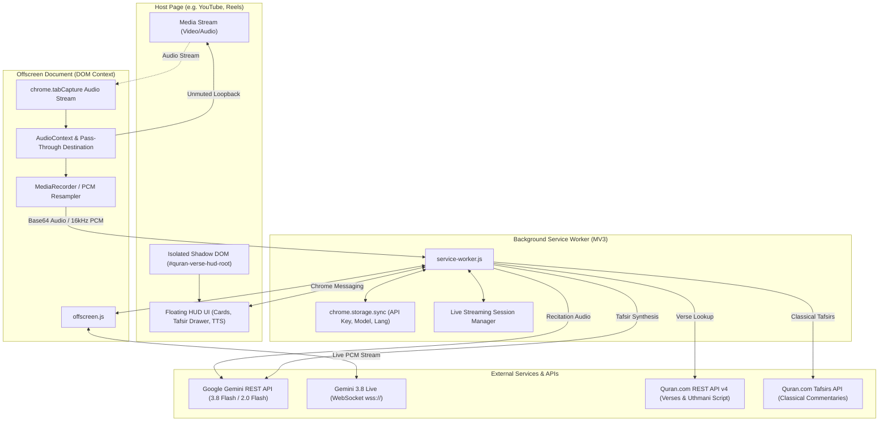
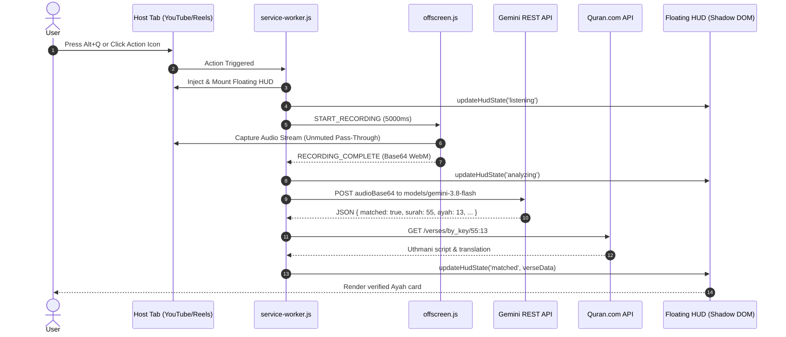
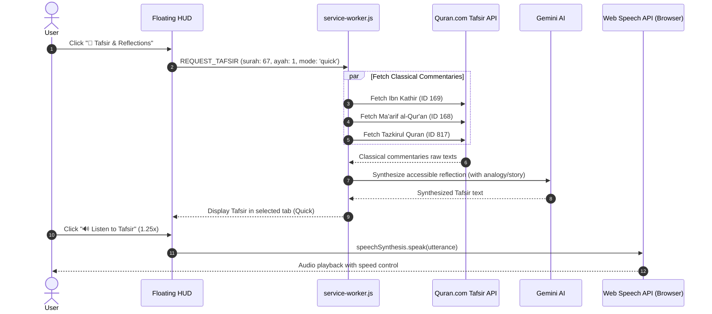

# Quran Verse Identifier — Comprehensive Project Overview

> **Version:** 1.0.0  
> **Platform:** Chrome Extension (Manifest V3)  
> **Core AI:** Google Gemini 3.8 / 2.0 Multimodal Audio & Gemini 3.8 Live WebSockets  
> **APIs:** Quran.com REST API v4 & Tafsirs API  
> **Test Suite:** 126 unit tests across 11 test suites (Vitest)

---

## 1. Executive Summary

The **Quran Recitation Verse Identifier** ("Recitation Shazam") is a Google Chrome Manifest V3 extension designed to identify Quran recitations in real-time from any audio playing inside a browser tab (YouTube, YouTube Shorts, Instagram Reels, Facebook, TikTok) or from the user's microphone.

Upon identification, it renders an on-page, draggable floating HUD displaying the verified Surah name, Ayah number, authentic Uthmani Arabic calligraphy, and localized translations.

Beyond simple identification, the project incorporates:
1. **Live Ayah-by-Ayah Streaming**: Continuous recitation tracking using Gemini Live (`models/gemini-3.8-live`) to follow recitations in real time.
2. **Multi-Source Classical Tafsir Synthesis**: Pulling classical commentaries (Ibn Kathir, Ma'arif al-Qur'an, Tazkirul Quran) and synthesizing accessible, everyday explanations with stories and analogies across three depth tiers (Quick 60–90s, Detailed, Comprehensive).
3. **Audio Reflections**: Text-to-Speech (TTS) narration with variable speed playback (1x, 1.25x, 1.5x).
4. **Style-Isolated Shadow DOM HUD**: Floating overlay immune to host website CSS interference.
5. **Lossless Audio Pass-Through**: Captures tab audio for recognition without muting the host tab's sound.

---

## 2. System Architecture

The extension is architected as an event-driven Chrome Manifest V3 application composed of five primary layers:



---

## 3. Subsystem Breakdown

### 3.1 Background Service Worker (`src/background/service-worker.js`)
- **Role:** Central orchestrator of extension lifecycle, user events, and external API requests.
- **Responsibilities:**
  - Listens for extension action clicks and global keyboard shortcut (`Alt+Q`).
  - Injects the floating HUD content script into active tabs.
  - Spawns and manages the Chrome MV3 offscreen document.
  - Coordinates one-shot audio capture and continuous live streaming sessions.
  - Handles Tafsir generation requests (`REQUEST_TAFSIR`) by delegating to the synthesis pipeline.
  - Manages configuration synchronization (`geminiApiKey`, `selectedModel`, `translationId`).

### 3.2 Offscreen Audio Capture Document (`src/offscreen/offscreen.html`, `offscreen.js`)
- **Role:** Bridges Chrome MV3's limitation where background service workers lack access to DOM Audio APIs and `MediaRecorder`.
- **Features:**
  - **Zero-Mute Audio Pass-Through:** In tab capture mode, routes the capture stream into an `AudioContext` and connects to `audioContext.destination`, ensuring video playback continues playing in user headphones.
  - **Dual Capture Modes:** Tab audio capture via `chrome.tabCapture.getMediaStreamId` and microphone capture via `navigator.mediaDevices.getUserMedia`.
  - **Sliding Window Chunking:** Slices audio into 5-second overlapping chunks for sliding-window seek recognition.
  - **16kHz Linear PCM Resampling:** Converts 44.1/48kHz browser audio into 16kHz single-channel 16-bit linear PCM required by Gemini Live WebSocket engines.
  - **Resource Cleanup:** Stops all media stream tracks on capture completion to dismiss Chrome's recording badge.

### 3.3 Gemini Audio & Live Engine (`src/services/gemini.js`, `gemini-live.js`)
- **One-Shot Seek Engine (`gemini.js`):**
  - Sends base64-encoded audio directly to `gemini-3.8-flash` (or user-selected model: `gemini-2.0-flash`, `gemini-2.5-flash`, `gemini-1.5-flash`).
  - Instructs Gemini via system prompts to act as an authoritative Quran scholar, outputting strictly structured JSON:
    ```json
    {
      "matched": true,
      "surah_number": 55,
      "surah_name": "Ar-Rahman",
      "ayah_start": 13,
      "ayah_end": 13,
      "confidence": 0.98,
      "recited_arabic": "فَبِأَيِّ آلَاءِ رَبِّكُمَا تُكَذِّبَانِ"
    }
    ```
- **Live Streaming Engine (`gemini-live.js`):**
  - Connects to `wss://generativelanguage.googleapis.com/ws/google.ai.generativelanguage.v1alpha.GenerativeService.BidiGenerateContent`.
  - Establishes bidirectional streaming over WebSockets, pushing real-time audio buffers and streaming continuous Ayah tracking updates.

### 3.4 Quran.com API Client & Matcher Coordinator (`src/services/quran-api.js`, `matcher.js`)
- **`quran-api.js`:**
  - Fetches authentic Uthmani script (`text_uthmani`) and verse metadata from `https://api.quran.com/api/v4/verses/by_key`.
  - Handles multi-verse spans (e.g., 112:1–4) by joining text and translation blocks accurately.
  - Provides language translation lookup with default fallback to Sahih International (ID `131`).
- **`matcher.js`:**
  - Orchestrates the sequence: Audio Capture $\rightarrow$ Gemini Identification $\rightarrow$ Quran.com Enrichment $\rightarrow$ Verified Result.
  - Fallback mechanism: If verse numbers are absent, falls back to Arabic text search via `searchQuran`.

### 3.5 Classical Tafsir & Reflection Engine (`src/services/tafsir-api.js`)
- **Classical Aggregation:**
  - Fetches interpretations from three renowned classical sources in parallel:
    1. **Ibn Kathir** (Resource ID `169`)
    2. **Ma'arif al-Qur'an** (Resource ID `168`)
    3. **Tazkirul Quran** (Resource ID `817`)
- **AI Reflection Synthesis:**
  - Gemini synthesizes the classical texts into relatable, engaging insights for everyday audiences using analogies and stories.
  - **Three Depth Tiers:**
    - `quick`: 60–90 second conversational summary with an analogy or relatable real-life story.
    - `detailed`: Thematic analysis exploring background, context, and practical modern applications.
    - `comprehensive`: Deep contextual study combining historical context, lingual nuances, and theological takeaways.
  - Deep links directly to `https://quran.com/{surah}/{ayah}/tafsirs` for users wishing to read the original classical manuscripts.

### 3.6 Floating HUD UI (`src/ui/floating-hud.js`, `floating-hud.css`)
- **Shadow DOM Style Isolation:** Mounted into `#quran-verse-hud-root` via `attachShadow({ mode: 'open' })`. Zero style bleed to or from host page CSS.
- **States Supported:**
  - `listening`: Pulsing radar animation with active Tab/Mic mode switcher.
  - `analyzing`: Modern spinning loader indicating audio processing.
  - `matched`: Displays Surah name, Ayah key, verified Uthmani script, translation, copy button, and Quran.com link.
  - `minimized`: Compact draggable badge showing Surah & Ayah with one-click restore.
  - `error`: User-friendly notification card with actionable recovery guidance.
- **Interactive Features:**
  - **Live Recitation Follower:** Live badge (`LIVE RECITATION`) with real-time Ayah updates.
  - **Decoupled Ayah Pinning:** Users can pin and inspect Tafsir for an earlier Ayah while live streaming continues in the background; a "Sync to Live" pill allows jumping back at any time.
  - **Expandable Tafsir Drawer:** Tabbed interface for Quick, Detailed, and Comprehensive depth versions.
  - **Audio Narration Player:** Web Speech TTS playback with 1x, 1.25x, and 1.5x speed options.
  - **Clamped Dragging:** Smooth drag-and-drop anchored to viewport boundaries.

---

## 4. Sequence Diagrams

### 4.1 Single-Shot Recitation Identification


### 4.2 Tafsir & Audio Narration Flow


---

## 5. Repository File Structure

```text
quran-verse-identifier/
├── manifest.json                  # Chrome Manifest V3 configuration
├── package.json                   # Dependencies, Vitest test scripts, ES Modules config
├── vitest.config.js               # Vitest runner configuration with jsdom
├── README.md                      # End-user setup and quickstart guide
│
├── assets/
│   └── icons/                     # Chrome Extension icons (16, 32, 48, 128 px, SVG)
│
├── src/
│   ├── background/
│   │   └── service-worker.js      # Central MV3 background orchestrator
│   │
│   ├── offscreen/
│   │   ├── offscreen.html         # Offscreen document host
│   │   └── offscreen.js           # Audio capture, pass-through & PCM streaming
│   │
│   ├── options/
│   │   ├── options.html           # Settings UI (API key, model picker, language)
│   │   ├── options.js             # Settings logic synced with chrome.storage.sync
│   │   └── options.css            # Settings styling
│   │
│   ├── services/
│   │   ├── arabic-normalizer.js   # Arabic text normalization & diacritics stripping
│   │   ├── gemini.js              # Gemini REST API identification & Tafsir synthesis
│   │   ├── gemini-live.js         # Gemini 3.8 Live WebSocket streaming engine
│   │   ├── matcher.js             # Recitation matching & Quran.com enrichment
│   │   ├── quran-api.js           # Quran.com REST API client
│   │   └── tafsir-api.js          # Multi-source classical Tafsir fetcher
│   │
│   └── ui/
│       ├── floating-hud.js        # Draggable Shadow DOM Floating HUD component
│       └── floating-hud.css       # Isolated stylesheet for Floating HUD
│
├── tests/
│   ├── manifest.test.js           # Manifest V3 schema and permission validation
│   ├── background/
│   │   └── service-worker.test.js # Service worker orchestration tests
│   ├── offscreen/
│   │   └── offscreen.test.js      # Audio capture, pass-through & message tests
│   ├── options/
│   │   └── options.test.js        # Options UI storage and model selection tests
│   ├── services/
│   │   ├── arabic-normalizer.test.js
│   │   ├── gemini.test.js
│   │   ├── gemini-live.test.js
│   │   ├── matcher.test.js
│   │   ├── quran-api.test.js
│   │   └── tafsir-api.test.js
│   └── ui/
│       └── floating-hud.test.js   # Shadow DOM, dragging, Tafsir drawer, and TTS tests
│
└── docs/
    ├── crx-zip-recovery-guide.md  # Forensic guide for recovering .zip from .crx
    └── superpowers/               # Specs and implementation plans
```

---

## 6. Testing & Quality Assurance

The project maintains a 100% green unit test suite using **Vitest** in an ES Module environment with `jsdom` for DOM-level validation.

```text
Test Suites: 11 passed (11)
Tests:       126 passed (126)
Duration:    ~3 seconds
```

### Coverage Highlights:
- **Manifest Conformance:** Validates MV3 permissions, content security policies, and resource declarations.
- **Audio Routing:** Verifies `AudioContext` routing to `destination` to prevent muting host tab sound.
- **Shadow DOM Isolation:** Tests mounting into isolated Shadow Roots and verifies immunity to external styling.
- **API Resilience:** Tests handling of network errors, malformed JSON, missing API keys, and rate limits.
- **UI Interaction:** Tests dragging bounds clamping, pill minimization, speed controls, and Tafsir tab switching.

---

## 7. Setup & Installation

### Step 1: Clone & Install
```bash
cd "d:\SDLC\Project Jugaru\quran-verse-identifier"
npm install
npm test
```

### Step 2: Load into Google Chrome
1. Navigate to `chrome://extensions` in Google Chrome.
2. Toggle **Developer mode** (top-right corner).
3. Click **Load unpacked**.
4. Select the folder: `d:\SDLC\Project Jugaru\quran-verse-identifier`.

### Step 3: Configure Gemini API Key
1. Right-click the extension icon in Chrome and select **Options** (or click Extension Options).
2. Enter your **Google Gemini API Key** (obtainable free from [Google AI Studio](https://aistudio.google.com/)).
3. Select your preferred **Gemini Model** (default: `Gemini 3.8 Flash`).
4. Select your preferred **Translation Language** (default: English - Sahih International).
5. Click **Save Settings**.

---

## 8. Keyboard Shortcuts & Usage

| Action | Shortcut / Trigger | Description |
|---|---|---|
| **Identify Tab Recitation** | `Alt + Q` (or click extension icon) | Captures active tab video/audio, identifies verse, and renders HUD. |
| **Microphone Mode** | Click `🎤 Mic` toggle in HUD | Switches capture source to microphone for live recitations in the room. |
| **Live Following** | Click `▶ Follow Live Recitation` | Starts continuous Ayah tracking via Gemini Live. |
| **Read/Hear Tafsir** | Click `📖 Tafsir & Reflections` | Opens classical Tafsir drawer with Quick/Detailed/Comprehensive views and TTS audio playback. |
| **Minimize / Restore** | Click `—` or double-click HUD | Collapses HUD into a small floating pill. |
